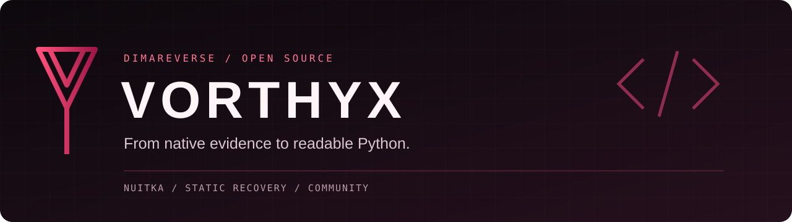
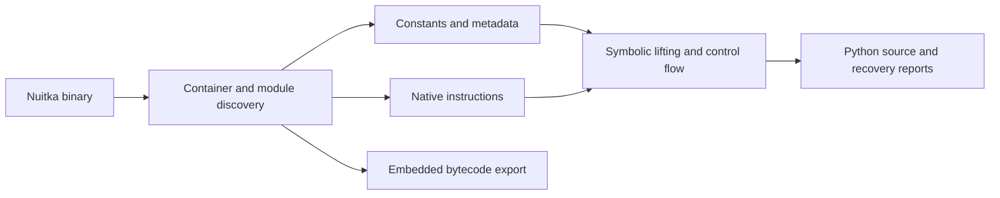

<p align="center">
  
</p>

<p align="center">
  <strong>Nuitka native code → readable Python. Built in the open.</strong><br>
  Static source recovery, embedded bytecode export, and onefile extraction by <a href="https://github.com/DimaReverse">DimaReverse</a>.
</p>

<p align="center">
  <a href="LICENSE"></a>
  <a href="https://github.com/DimaReverse/vorthyx/actions/workflows/ci.yml"></a>
  
  <a href="https://github.com/DimaReverse/vorthyx/stargazers"></a>
</p>

<p align="center">
  <a href="#quick-start">Quick start</a> · <a href="docs/USAGE.md">Usage</a> · <a href="docs/LIMITATIONS.md">Limitations</a> · <a href="CONTRIBUTING.md">Contribute</a> · <a href="#a-personal-thank-you">Thank you</a> · <a href="docs/README.it.md">Italiano</a>
</p>

## Why VORTHYX?

Nuitka compiles Python into native machine code. Recovering that code takes more than extracting a `.pyc`: it means connecting constants, module metadata, native helpers, registers, source locations, and control flow.

VORTHYX continues my work on [HEXPYRION](https://github.com/DimaReverse/hexpyrion) and [REVENANT](https://github.com/DimaReverse/nuitka-revenant), alongside the separate [Nuitka/Themida unpacking project](https://github.com/DimaReverse/nuitka-themida-unpacker). This repository brings the supplied VORTHYX engine into a focused open-source home with reproducible checks and room for community improvements.

**Research preview:** native recovery is best effort. A file that parses is not proof that it behaves like the original. Read the reports, inspect unresolved sections, and validate recovered behavior. No universal recovery or benchmark advantage is claimed.

## What you can do

| Capability | What it provides |
| --- | --- |
| **NDX native recovery** | Module discovery, ABI analysis, helper classification, symbolic lifting, control-flow structuring, and Python emission. |
| **Focused analysis** | Select first-party modules or filter module names to reduce work on large applications. |
| **Embedded bytecode export** | Export surviving code objects and a manifest; this is separate from reconstructing native-only modules. |
| **Onefile extraction** | A static extraction path for recognized containers, including Zstandard payloads. |
| **Recovery diagnostics** | Module reports and detectable-gap checks, including the NDX `--strict` option. |
| **Two command interfaces** | The integrated NDX engine and the legacy extraction/reconstruction interface. |

Container recognition includes PE, ELF, and Mach-O paths. Native lifting and individual compiler patterns have narrower coverage; see [limitations](docs/LIMITATIONS.md). VORTHYX does not include the external Themida/WinLicense unpacking pipeline.

## Quick start

Use Python **3.11** for the initial setup; it is the interpreter used for the local release checks. Other interpreters are covered only as far as the published CI results show.

```sh
git clone https://github.com/DimaReverse/vorthyx.git
cd vorthyx
python -m venv .venv
```

Activate the environment:

```powershell
# Windows PowerShell
.venv\Scripts\Activate.ps1
```

```sh
# Linux / macOS
source .venv/bin/activate
```

Install and inspect the NDX interface:

```sh
python -m pip install -r requirements.txt
python nuitka_decompiler.py --ndx --help
```

Recover modules from a binary you own or are authorized to inspect:

```sh
python nuitka_decompiler.py --ndx ./your_app.exe -o ./recovered --dev-only
```

Detectable gaps can make the command fail with status `2`:

```sh
python nuitka_decompiler.py --ndx ./your_app.exe -o ./recovered --strict
```

A successful exit does not certify semantic equivalence. [Usage](docs/USAGE.md) explains the output, optional dependencies, and the two interfaces.

## How recovery fits together



Static paths analyze the target without launching it. The source also retains explicit runtime instrumentation modes; those execute or interact with a target process and are outside the quick start. Static parsing itself is not a sandbox. Use an isolated environment for untrusted inputs.

## A personal thank you

To everyone who took an interest in my story, checked in on me, or simply stayed around: **thank you**. Your support matters beyond any repository, release, or star count.

To everyone who suggested a feature, reported a bug, tested a difficult case, opened an issue, or made a fork: you helped this work move forward. Even a small observation can become the clue that fixes something important. I am grateful for the time and curiosity you shared.

VORTHYX carries that encouragement into the next chapter. Fork it, experiment, document what works, and share what you learn. If your fork or contribution deserves a mention, open a pull request to [ACKNOWLEDGMENTS.md](ACKNOWLEDGMENTS.md) with a public link so the credit stays accurate.

— **DimaReverse**

## Build the next improvement

The most useful contributions are small reproducible cases, clearer recovery diagnostics, compiler-pattern fixes, and documentation that helps the next person. Start with [CONTRIBUTING.md](CONTRIBUTING.md) and the [validation guide](validation/README.md). The [publication code review](docs/CODE_REVIEW.md) records the architecture, checks, and known CLI issues.

If VORTHYX helps you, a star, an issue with a good reproducer, or a link to your research helps other people discover it. Forks are welcome; please preserve the license and credit the work you build on.

## License and lineage

[MIT](LICENSE). Earlier project notices are preserved in [NOTICE](NOTICE). See [acknowledgments](ACKNOWLEDGMENTS.md) for the project lineage and tooling credits.

VORTHYX is an independent project, unaffiliated with and not endorsed by Nuitka. Analyze software you own or have permission to inspect, and respect applicable licenses and rights.
